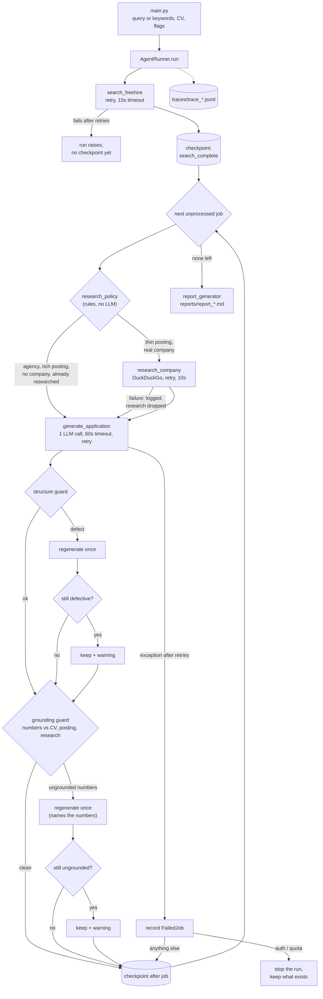

# Architecture and Decisions

For engineers reading the code. It says what each part does, why it is built that way, what evidence supports it, and where it is weak. Evidence is labelled: **Unit** (tests with fakes), **Induced** (real code, deliberately provoked faults), **Live** (real services, normal operation).

## In one paragraph

A fixed pipeline, not an LLM-driven agent. One search, then one pass over the jobs. For each job a deterministic rule decides whether to research the company, the model drafts a CV-bullet list and cover letter, two guards check the draft, and the result is checkpointed. The model never chooses a tool or the control flow. Every step writes an event to a JSONL audit trail; every job writes a checkpoint. A failing job is recorded and skipped, not fatal.

## The pipeline



At most three LLM calls per job: draft, structure retry, grounding retry. Jobs are processed sequentially; there is no concurrency.

## Modules (`src/job_agent/`)

| Module | Responsibility |
|---|---|
| `main.py` | CLI: query/keywords, `--cv`, `--model`, `--retry-model`, `--resume`, `--run-id`, `--list-interrupted`; prints cost and warnings |
| `agent_runner.py` | The pipeline: search, per-job loop, both guards, failure recording, abort, checkpointing |
| `tools.py` | `search_freehire`, `search_duckduckgo`, `research_company`; each wrapped in the retry layer |
| `research_policy.py` | `should_research`: the deterministic escalation rule and its reasons |
| `application_generator.py` | Builds the prompt, calls the model, parses JSON; an unparseable or empty reply becomes an empty draft for the guard to catch |
| `format_rules.py` | One source for length limits and `application_defects` (shared by the prompt, the runtime guard and the evals, so they cannot drift) |
| `grounding.py` | Extracts numbers and finds those absent from the allowed sources (shared with the evals) |
| `llm_client.py` | The only OpenAI caller: retry, timeout, usage recording, per-call model routing, tagging calls by job and purpose |
| `retry.py`, `failures.py` | Bounded retry with backoff; classification of exceptions into categories and policies |
| `routing.py`, `pricing.py` (+ `pricing.json`), `usage.py` | Which model serves which call; list-price cost estimates; token accounting |
| `checkpoint.py`, `audit_logger.py` | JSONL state snapshots and JSONL event trail |
| `report_generator.py`, `view_trace.py` | Markdown report per run; trace viewer |
| `config.py` | Timeouts in one place (LLM 60s, FreeHire 15s, DuckDuckGo 10s) |

`evals/` is a second program that drives `AgentRunner` and scores it; `evals/stress/` injects faults. See the last section.

## State and recovery

- **Checkpoint:** one JSONL line per save, holding the query, the jobs found, the ids processed, the applications, the failed jobs and a status. Saved after the search, after every job (success or failure) and at the end. Append-only, so a crash cannot corrupt earlier lines; a corrupted line is skipped on load.
- **Resume** (`--resume --run-id X`) reloads the latest valid checkpoint, does not search again, skips finished jobs, **retries previously failed jobs**, and processes the rest. A missing query reuses the saved one, a different query is refused, and a run that used a CV is refused unless `--cv` is passed again (otherwise the remaining letters would silently come from the placeholder profile). Runs with a status other than `completed` (including `partial`) are listed by `--list-interrupted`.
- **Lost on resume:** usage figures, research decisions and the research cache are not checkpointed. A resumed run's cost line covers only the resumed part.
- **Evidence:** `kill -9` inside job 3 of 4, then resume: jobs 1-2 kept, no new search, jobs 3-4 generated, no duplicates (**Induced**, scenario B6).

## Failure handling

`failures.classify_exception` maps an exception to a category and a retry policy. Only categories the code can emit exist.

| Category | Emitted for | Policy |
|---|---|---|
| `TIMEOUT` | timeouts, dropped connections, HTTP 408 | retry, up to 3 attempts, 1s then 2s |
| `DEAD_API` | 429, 5xx, refused connections, OpenAI rate limit / 5xx | same |
| `MALFORMED_RESPONSE` | non-JSON body (retried); HTTP 400; OpenAI 400/404/422, meaning our request was rejected (not retried) | see left |
| `AUTH_ERROR` | 401/403; `insufficient_quota` (manual intervention) | none |
| `CONTEXT_OVERFLOW` | `context_length_exceeded` | one retry with the history halved (cannot shrink a 2-message prompt, so effectively dead) |
| `UNKNOWN` | anything else | none |

How failures propagate:
- **Per job:** the exception that survives retry fails that job only. It is recorded as a `FailedJob` with its category and the real attempt count, and the loop continues. The run ends `completed`, `partial` (some applications) or `failed` (none).
- **Auth or quota failure:** every remaining job would fail the same way, so the run stops after recording it, keeps what was produced, logs `run_aborted`, and tells the CLI user how to resume.
- **Search failure:** the run fails with an exception; nothing was checkpointed yet, so there is nothing to resume.
- **Research failure:** never fails a job; the letter is written without research.
- **Evidence:** 26 induced scenarios, including real exception types from `openai`, `requests` and the DuckDuckGo client, all match their written expectations (`docs/baselines/stress_faults_20261019.md`). Real API errors and measured backoff (1.01s, 2.01s) were confirmed against the live API (`docs/baselines/stress_api_errors_20261019.md`). **Organic failure data is nearly empty**: no live eval run has had a failed attempt.

## Decisions

### D1. A fixed pipeline instead of an LLM-driven loop
**Chosen:** code decides the order of steps; the model writes text.
**Rejected:** the original design, where the model chose the next tool inside a loop with 12 guardrails and token pruning.
**Why:** checkpointing needs a well-defined unit of work (one job); the policy and the guards have to be testable without a model; a loop made every run a different sequence. The loop was removed in the Day 11 checkpointing rewrite.
**Cost:** nothing adapts. There is one search source and one fixed order.
**Lesson recorded:** that rewrite silently dropped features (CV support among them) and the docs kept describing the old loop for weeks until Day 18. Preserve public symbols and check git history before assuming a feature exists.

### D2. A deterministic research policy
**Chosen:** `should_research` returns `(decision, reason)` from rules: no company, agency by name, agency by posting language, already researched this run, description of 600+ characters, else research.
**Why:** it is cheap, explainable (the reason is traced), and testable offline. 19 hand-labelled scenarios pass and are mutation-checked, so a changed threshold or a broken agency rule makes them fail (**Unit**).
**Weak points, measured:** the 600-character threshold sits in an empty gap in the data (descriptions were at most 501 or at least 1306), so it is not sensitive. The agency rules are heuristics tuned on 112 saved postings. They miss agencies such as Eden Scott and RecOps; in both cases the model still wrote an appropriate letter (**Live**). The posting-language rule fired live once in 68 jobs.

### D3. Guards regenerate once, then flag, rather than block or loop
**Chosen:** a bad draft is regenerated at most once with a note saying what was wrong. If it is still bad it is kept with a warning that the report and the CLI show.
**Rejected:** looping until clean (unbounded cost), and dropping the job (loses work the user could fix by hand).
**Why:** bounded cost (at most 3 calls per job) and the human sees the problem.
**Evidence (Induced, live model):** empty-bullet drafts recovered 6 of 6 and were flagged in the report 6 of 6 when the retry failed too; 3 of 3 ungrounded-number drafts were regenerated clean, one of which the model produced without being asked to. **Not proven:** that the "ship with Review needed" path works for a grounding failure (the retry never failed), and how often the model fails unprovoked (0 in 68 applications in the two eval runs).
**Limit:** grounding checks numbers only. An invented skill or employer without a figure passes.

### D4. JSONL for traces and checkpoints
Append-only writes survive a crash, a run can be followed with `tail -f`, and `grep` or `jq` is enough to inspect one. The alternatives were SQLite (a dependency, harder to read by eye) and a single JSON file (rewrites everything on each save). Cost: no queries; fine at this scale.

### D5. Bounded retry, classified by cause
Three attempts, 1s then 2s, and only for causes that can clear on their own. A bad key or a rejected request is never retried. Retrying is applied in one layer (`retry.py`), and the OpenAI client is created with `max_retries=0` so attempts are not multiplied.
**Weak points:** `Retry-After` is not honoured, so a sustained rate limit still fails the job after 3 attempts.
**Found by testing, not by users:** HTTP errors were all `UNKNOWN` for weeks because `if exception.response` is falsy for 4xx/5xx responses. Fixed Day 20, **Unit** test uses real `Response` objects.

### D6. Stop the run on auth or quota errors
Continuing would make one doomed call per remaining job and bury the real cause. The run stops, saves, and `--resume` finishes the rest after the key is fixed (**Induced**, B7c: 401 on job 2 of 3 stops after 2 calls; resume completes all 3).

### D7. Resume retries failed jobs
**Found Day 22** by injecting a fault, not by reading: a failed job was counted as processed, so `--resume` skipped it and the run stayed `partial` with zero calls. Now failed jobs are dropped from the processed set on resume and tried again; a job that fails again gets one fresh record.
**Cost:** a deterministic failure is retried once per resume.

### D8. One model by default, an optional retry model
`gpt-4o-mini` serves every call. `--retry-model` routes only the two retry purposes elsewhere. Day 19 compared four models on 6 queries (12 applications each): `gpt-4o-mini` and `gpt-4.1-mini` passed 6/6, `gpt-4.1-mini` at 2.85x the cost; `gpt-5-nano` and `gpt-5.4` passed 3/6, the latter at 32x the cost, mostly on length limits the prompt did not then state. The prompt has changed since, so that comparison is out of date. Whether a stronger retry model is worth it is unanswered (n=1 in the induced run).
Costs are list-price estimates (4 models in `pricing.json`); an unknown model is reported as unpriced, never guessed.

### D9. Evals are the quality gate, and they are themselves tested
A 20-query golden dataset in five categories, per-application checks (format, addressing, grounding), run-level checks (relevance, tool use, escalation), and a mock mode that validates the harness only. Rules: a heuristic check needs synthetic bad cases and a replay on saved real data; when a check never fails on real data, say so. Two checks produced false positives on real letters (a company slug where the letter used the trading name), and were fixed and re-scored on the same data, which the baseline notes as a limit.
**Current numbers:** 17/20 as run and 18/20 after the check fix on the latest run, 19/20 on the previous one; the spread between identical code is about two queries. $0.0005 per application, mean 8-9s per query (`docs/BASELINE.md`).

### D10. A single LLM provider, behind one file
All model calls go through `llm_client.py`. Swapping providers means changing that file and the exception mapping in `failures.py`. Not done, because no second provider is needed for the case.

### D11. The failure taxonomy contains only what the code emits
Three categories existed that nothing ever produced (`MISSING_DATA`, `PARTIAL_COMPLETION`, `GUARDRAIL_TRIGGERED`). Their situations are already recorded precisely (`structure_*` and `grounding_*` events, the run `status`), so a second label would duplicate them. Removed on Day 23. A test pins the set.
**Naming limit:** an OpenAI 404 for an unknown model is filed under `MALFORMED_RESPONSE` (our request was rejected). The category name is imprecise, the message and policy are correct.

## Limits

- **Search is UK only** and takes one page; no pagination, no deduplication across runs.
- **Truncated descriptions:** two of the sources cut descriptions at about 500 characters upstream, so "thin posting" mostly means "truncated".
- **Sequential processing;** a 20-job run takes minutes, not seconds.
- **Grounding covers numbers only;** relevance is keyword matching on titles; the golden dataset's keywords are hand-written guesses.
- **One CV, one model, small non-deterministic samples** (34 jobs per run).
- **Privacy:** the audit trail used to store every prompt in full, CV included. Since Day 26 `redact_for_log` replaces long strings and chat messages with their length and a 12-character hash before anything is written (a test fails if the CV or the posting text reaches the trace). Still open: checkpoints and reports contain the generated letters, which are derived from the CV; traces written before the fix still contain it; there are no retention rules, access control or threat model. The CV is also sent to the model provider by design.
- **Cover letters need human review.** The guards narrow the risk and say so when they cannot clear it.
- The model writes about 173 words regardless of the numeric target in the prompt; the target was lowered to match, and 2 of 34 letters in the latest run were under the 150-word floor.

## Verifying it yourself

```bash
python -m pytest tests -q                       # offline; fakes only
python -m evals.runner --scenarios-only         # 19 tool-selection scenarios, offline
python -m evals.stress.faults                   # 26 induced faults, offline, free
python -m evals.stress.api_errors               # live, no CV: real API errors and backoff
python -m evals.stress.guards --cv <cv.md>      # live, sends the CV: provokes both guards
python -m evals.runner --live --max-jobs 2      # live baseline, about $0.02
```
