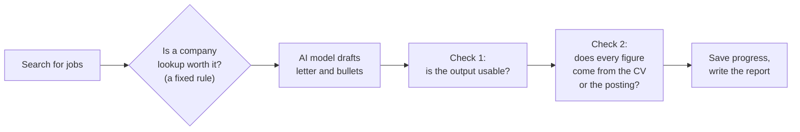

# Case Study: An AI Workflow Built to Fail Safely

A short account of a 30-day project: what was built, how it was tested, what went wrong, and what the evidence does and does not show. It is written for readers who are not all engineers. Each technical term is explained where it first appears. Longer treatments are listed at the end.

## In brief

The project is a program that writes tailored job applications. Given a search, it finds matching jobs, decides whether to research each company, and asks an AI model to draft a cover letter and CV bullet points from the candidate's real CV. The program is built around one idea: **a draft the reader will act on must be checked, and when it cannot be trusted the system has to say so instead of failing quietly.**

The result is a working prototype that drafts an application for about a twentieth of a cent, recovers from the failures that were tried on it, and flags drafts it cannot vouch for. It is a command-line tool for one user. It is not a product, and it does not replace reading each letter.

## The problem

A good application is several tasks: search several sources, read the posting, research the company, match your CV, write something true and relevant. Doing that by hand for many postings is slow and repetitive, and quality drops with fatigue. An AI model can do the writing step well. It can also do three things that matter a lot here: invent a figure that is not on your CV, address a recruiter as if they were the employer, or hand back something broken and present it as finished. A letter with an invented "40% improvement" sent under your name is worse than no letter.

So the question was never "can a model write a letter". It was: **can the surrounding system make that safe enough to rely on, and can that be shown with evidence?**

## What was built

Four design choices carry most of the weight:

- **Code decides the order; the model only writes.** The first version let the model choose its own next step. It was harder to test and behaved differently on each run, so it was replaced by a fixed sequence. The model does one job.
- **Checks, then a warning, instead of trust.** If a draft fails a check it is regenerated once with a note saying what was wrong. If it fails again it is kept with a visible "Review needed" warning, and the cost is capped at three model calls per job.
- **Progress is saved after every job.** If the program crashes, it resumes where it stopped. If one job fails, the others are still delivered. If the failure would hit every remaining job (a wrong key, an exhausted account), the run stops and says how to continue.
- **Everything is logged,** without logging the private CV. The log records every attempt and decision.

## How it was tested

The evidence comes in three kinds, and every number in this document says which kind it is:

- **Unit** tests use pretend (fake) models and services, and check the logic quickly and for free. There are 289 automated tests, including the scripted failure scenarios.
- **Measured** results come from real runs against the real job search and the real AI model, on 20 test searches.
- **Induced** results come from provoking failures on purpose, because real failures were too rare to learn from: scripted faults with the real error types, and telling the live model to break each rule. They show the safeguards work. They say nothing about how often failures happen.

| What | Result | Kind |
|---|---|---|
| Cost to draft one application | about $0.0005 (a twentieth of a cent; a thousand drafts is about 50 cents) | Estimate at list prices, small model |
| Time for a search that drafts 2 applications | about 10 s (9.8 s and 10.6 s in two runs, search and company lookups included) | Measured |
| Test searches passing | 18 of 20, then 17 of 20; 19 and 18 after correcting mistakes in the test's own checker. Identical code differs by about two between runs | Measured |
| Invented figures, with no prompting | 0 in 68 drafts. The true rate is unknown | Measured |
| Real failures during the live runs | none | Measured |
| Provoked failures handled as designed | 26 of 26 (rate limits, timeouts, a wrong key, a process killed mid-run, an empty model reply) | Induced |
| Checks when the live model is told to break the rules | invented figures caught and fixed 3 of 3; unusable output fixed 6 of 6, and flagged when the fix also failed 6 of 6 | Induced |
| Real error messages and waiting times against the live service | 4 of 4 as predicted; waits of 1.01 s and 2.01 s | Induced |

## What went wrong

The most useful part of the project is how it went wrong. Five episodes stand out; the full set is in the iteration story.

1. **A rewrite quietly removed features.** To add progress-saving, the second week's work rewrote the main program and, in the same change, dropped the model-driven loop, company research and the use of the candidate's CV. For four days the letters were written from a generic placeholder profile, while the documentation said CV tailoring worked. Nothing failed visibly, because the demonstration ran on pretend data. It was found by comparing old and new code line by line.
2. **The search ignored the query.** At one point the job search silently returned an unfiltered feed. Tests with canned data could not see it. The first run against the real service did, and the system now refuses to continue if the service says it ignored the query.
3. **The model invented figures.** In the first full live run a letter claimed a 40% and a 25% improvement that were not on the CV. The test caught it, nothing at runtime did. That led to the check that compares every figure against the CV and the posting.
4. **Tests that passed for the wrong reason.** After a bug was fixed in how interrupted runs resume, two older tests meant to cover it still passed, because the program swallowed a failure inside their pretend components. A green result had meant nothing.
5. **The log held the private CV.** While preparing for a security question, a real log file showed the full instructions sent to the model, CV included. The log now keeps only a length and a short fingerprint, and a test fails if the CV ever reaches it.

The common thread: **green did not mean working.** Mock data, passing tests and confident documents all agreed with each other while the behaviour was wrong. The fixes came from running the real thing, reading its output, or breaking it on purpose.

## What this shows, and what it does not

It shows that a model-based workflow can be built so that failures are handled and visible, and that this can be demonstrated with labelled evidence. It shows the habit of finding one's own mistakes and writing them down.

It does not show:

- **How often the model goes wrong unprompted.** Zero in 68 drafts is a small sample from one CV and one model.
- **Protection against everything.** The figure check covers numbers only; an invented skill without a number gets through. Every letter still needs a human to read it.
- **Production readiness.** There is no web service or public interface, no deployment, no user accounts or access control, and no security review. The CV is sent to the AI provider by design, and generated letters are stored on disk without retention rules.
- **That a stronger model is not worth the cost.** The comparison that favoured the small model came before a later change to the instructions, and one question (whether a stronger model should handle retries) is still open.
- **Time saved.** No figure was measured, so none is claimed.

## Where to read more

| If you want to know... | Read |
|---|---|
| Why this problem, and where AI does and does not belong | `docs/PAIN_POINT.md` |
| How it is built, and why each choice was made | `docs/ARCHITECTURE.md` |
| What went wrong, in order, with commits | `docs/ITERATION_STORY.md` |
| The live test results in detail | `docs/BASELINE.md` and `docs/baselines/` |
| Every failure mode and how it was observed | `docs/FAILURE_TAXONOMY.md` |
| The four-model cost and quality comparison | `docs/MODEL_COMPARISON.md` |
| What happened on each day | `docs/PROGRESS.md` |
| The 10-minute and 5-minute talks | `docs/PITCH_ENGINEER.md`, `docs/PITCH_VP.md` |
| How to run it | `README.md` |
